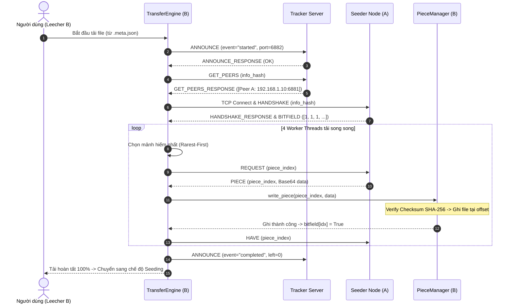

# 📖 TÀI LIỆU CONTEXT DỰ ÁN P2P FILE SHARING (PBL4)

Tài liệu này tổng hợp toàn bộ ngữ cảnh, kiến trúc, cấu trúc thư mục, giao thức truyền thông, thuật toán và hướng dẫn vận hành hệ thống chia sẻ file ngang hàng (Peer-to-Peer File Sharing).

---

## 1. 📌 TỔNG QUAN DỰ ÁN

- **Tên dự án:** P2P File Sharing System (Dự án Cơ sở Mạng & Hệ điều hành - PBL4).
- **Mục tiêu:** Xây dựng hệ thống chia sẻ tập tin ngang hàng qua mạng (Localhost và mạng LAN), lấy cảm hứng từ kiến trúc BitTorrent.
- **Mô hình kiến trúc:** **Hybrid P2P**
  - **Tracker Server tập trung:** Đóng vai trò thư mục (Directory service), quản lý danh sách các Swarm theo `info_hash` và địa chỉ `IP:Port` của các Peer đang online. Tracker **không** lưu trữ hay trung chuyển dữ liệu file.
  - **Mạng Peer phân tán:** Các Peer kết nối TCP trực tiếp với nhau (Direct P2P socket connection) để truyền tải song song từng mảnh file (Pieces).
- **Công nghệ & Ngôn ngữ:** Python 3 (sử dụng 100% Standard Library: `socket`, `threading`, `hashlib`, `json`, `struct`, `base64`, `os`, `sys`, `time`, `random`). Không phụ thuộc thư viện bên ngoài.

---

## 2. 📂 CẤU TRÚC THƯ MỤC & MÃ NGUỒN

```text
p2p-file-sharing/
├── run_tracker.py                  # Entry-point khởi chạy Tracker Server
├── run_client.py                   # Entry-point CLI chạy P2P Client (Seeder / Leecher)
├── protocol/                       # Đóng gói và giao thức mạng
│   ├── __init__.py
│   └── messages.py                 # Định nghĩa MessageType, Socket Framing, Message Builders
├── tracker/                        # Quản lý Swarm và Tracker Server
│   ├── __init__.py
│   ├── state.py                    # TrackerState: Quản lý danh sách Peer theo info_hash (Thread-safe)
│   └── tracker_server.py           # TrackerServer: Server TCP xử lý ANNOUNCE, GET_PEERS, dọn dẹp định kỳ
├── storage/                        # Xử lý tệp tin và lưu trữ đĩa cứng
│   ├── __init__.py
│   ├── metainfo.py                 # Tạo/đọc file .meta.json, băm SHA-256 từng mảnh và info_hash
│   └── piece_manager.py            # PieceManager: Cấp phát đĩa, đọc/ghi offset bằng seek(), verify checksum
├── peer/                           # Trọng tâm truyền tải P2P
│   ├── __init__.py
│   ├── client.py                   # P2PClient: Điều phối Seeding và Downloading, tự động lấy IP LAN
│   ├── peer_node.py                # PeerNode: TCP Server phục vụ Upload cho các Peer khác (Seeding)
│   ├── transfer_engine.py          # TransferEngine: Động cơ tải đa luồng (Multi-workers), Resume download
│   └── selection.py                # Thuật toán chọn mảnh: Rarest-First & Random
├── tests/                          # Kiểm thử hệ thống
│   ├── __init__.py
│   ├── test_peer.py                # Test thuật toán Rarest-First & Test End-to-End P2P File Transfer
│   └── README.md                   # Tài liệu giải thích bộ test
├── demo_workspace/                 # Thư mục dữ liệu chạy thử nghiệm
│   ├── shared/                     # Chứa file chia sẻ và file .meta.json
│   └── downloads/                  # Chứa file tải về thành công
├── docs/
│   └── HUONG_DAN_CHI_TIET.md       # Giải thích chi tiết mã nguồn và từng hàm
├── lich.md                         # Kế hoạch phát triển 16 tuần của nhóm
└── PROJECT_CONTEXT.md              # File ngữ cảnh tổng hợp toàn bộ dự án (File này)
```

---

## 3. 🌐 GIAO THỨC TRUYỀN THÔNG (NETWORK PROTOCOL)

### 3.1. Socket Framing (Khắc phục lỗi xé gói TCP Fragmentation)
TCP là một byte-stream protocol, không có ranh giới tin nhắn. Dự án sử dụng kỹ thuật **Length-Prefix Framing**:
- **4 Bytes Header (`>I` - Unsigned Int, Big-Endian):** Chứa độ dài $L$ của dữ liệu JSON phía sau.
- **Payload:** Chuỗi JSON đã mã hóa UTF-8 có độ dài đúng $L$ bytes.
- Hàm `recv_exact(sock, num_bytes)` đảm bảo đọc đủ số bytes yêu cầu trong vòng lặp trước khi giải mã.

### 3.2. Mã hóa dữ liệu nhị phân (Binary Chunks)
Khi truyền dữ liệu file nhị phân qua giao thức JSON:
- Dữ liệu mảnh (Piece data) được encode sang **Base64 ASCII string** qua `base64.b64encode()`.
- Phía nhận giải mã qua `base64.b64decode()` trước khi kiểm tra SHA-256 và ghi xuống đĩa.

### 3.3. Bảng các loại thông điệp (`MessageType`)

| Thông điệp | Vai trò | Bên gửi ➔ Bên nhận | Payload chính |
| :--- | :--- | :--- | :--- |
| `ANNOUNCE` | Báo danh với Tracker (bắt đầu, định kỳ, hoàn tất, dừng) | Peer ➔ Tracker | `info_hash`, `peer_id`, `ip`, `port`, `event`, `downloaded`, `left` |
| `ANNOUNCE_RESPONSE`| Phản hồi từ Tracker | Tracker ➔ Peer | `status: "OK"`, `interval: 30` |
| `GET_PEERS` | Xin danh sách các Peer đang có file | Peer ➔ Tracker | `info_hash`, `peer_id` |
| `GET_PEERS_RESPONSE`| Trả về danh sách Peer | Tracker ➔ Peer | `peers: [{"peer_id", "ip", "port"}, ...]` |
| `HANDSHAKE` | Bắt tay kết nối P2P trực tiếp | Leecher ➔ Seeder | `info_hash`, `peer_id` |
| `HANDSHAKE_RESPONSE`| Chấp nhận bắt tay | Seeder ➔ Leecher | `info_hash`, `peer_id` |
| `BITFIELD` | Thông báo các mảnh hiện có | Seeder ➔ Leecher | `bitfield: [True, False, True, ...]` |
| `REQUEST` | Yêu cầu gửi 1 mảnh | Leecher ➔ Seeder | `piece_index: int` |
| `PIECE` | Gửi dữ liệu mảnh | Seeder ➔ Leecher | `piece_index`, `data: "<base64_string>"` |
| `HAVE` | Broadcast báo mạng ta vừa có thêm 1 mảnh mới | Peer ➔ Các Peer khác | `piece_index: int` |
| `KEEP_ALIVE` | Giữ kết nối socket mở | Peer ⇄ Peer | `{}` |

---

## 4. ⚙️ KIẾN TRÚC & CÁC THÀNH PHẦN CỐT LÕI

### 4.1. Metadata & Piece Storage (`storage/`)
- **Kích thước mảnh chuẩn (`DEFAULT_PIECE_LENGTH`):** `512 KB` (524,288 bytes).
- **`info_hash`:** Băm SHA-256 từ canonical JSON của cấu trúc info (`name`, `file_size`, `piece_length`, `pieces`). Định danh duy nhất cho file trong toàn mạng.
- **Cấp phát đĩa (`Pre-allocation`):** `PieceManager` dùng `truncate(file_size)` để giữ trước khoảng trống đĩa, tránh phân mảnh và lỗi thiếu dung lượng giữa chừng.
- **Ghi không theo thứ tự (`Out-of-order writes`):** Ghi trực tiếp vào vị trí `offset = piece_index * piece_length` bằng lệnh `seek()` kết hợp `threading.Lock()`.
- **Kiểm tra tính toàn vẹn (Checksum Integrity):** Dữ liệu mảnh nhận về bắt buộc phải có hash SHA-256 trùng khớp với `expected_hashes[piece_index]`, nếu không sẽ bị hủy bỏ ngay lập tức.

### 4.2. Tracker Server (`tracker/`)
- Quản lý cấu trúc `swarms = { info_hash: { peer_id: peer_info } }`.
- Luồng dọn dẹp chạy ngầm (`_periodic_cleanup`): Tự động xóa các Peer không gửi heartbeat quá thời gian timeout (mặc định 60-120s).
- Tự động nhận diện IP LAN thực tế do Peer khai báo để phục vụ kết nối đa máy trong mạng nội bộ.

### 4.3. Peer Client & Transfer Engine (`peer/`)
- **Mô hình Hybrid Node (`P2PClient`):** Mỗi client đồng thời chạy:
  - 1 `PeerNode` (Server upload): Lắng nghe cổng cố định, hỗ trợ upload nhiều file khác nhau qua bảng ánh xạ `{info_hash: PieceManager}`.
  - Các `TransferEngine` (Client download): Chạy luồng ngầm cho từng file đang tải. Ngay khi tải được 1 mảnh, `PeerNode` lập tức có thể upload mảnh đó cho peer khác.
- **Worker Pool Đa luồng Tải Song Song:** Mặc định 4 worker threads. Mỗi worker thread duy trì kết nối socket độc lập tới các peer để tránh block lẫn nhau.
- **Chiến lược Rarest-First (`peer/selection.py`):** Đếm tần suất xuất hiện của từng mảnh thiếu trong danh sách bitfield của các peer kết nối. Ưu tiên tải mảnh có tần suất ít nhất trong mạng để cân bằng độ phủ dữ liệu trong swarm.
- **Cơ chế Resume Download:** Định kỳ ghi trạng thái `bitfield` ra `<file>.progress.json`. Khi mở lại, client nạp lại tiến độ từ file json mà không cần quét lại SHA-256 toàn bộ đĩa.

---

## 5. 🔄 LUỒNG HOẠT ĐỘNG END-TO-END (SEQUENCE DIAGRAM)



---

## 6. 🚀 HƯỚNG DẪN CHẠY VÀ THỬ NGHIỆM CHI TIẾT

### 6.1. Chạy trên cùng 1 máy tính (Localhost Test)

Mở 3 cửa sổ Terminal (PowerShell hoặc Command Prompt) tại thư mục `p2p-file-sharing`:

#### 🔹 Terminal 1: Khởi động Tracker Server
```powershell
python run_tracker.py
```
*Tracker sẽ lắng nghe tại `0.0.0.0:8000`.*

#### 🔹 Terminal 2: Khởi động Peer A (Seeder - Chia sẻ file)
```powershell
python run_client.py 6881
```
1. Chọn `1` (Chia sẻ file).
2. Nhập đường dẫn file cần chia sẻ (ví dụ: `demo_workspace/shared/my_video.mp4`).
3. Client sẽ tính SHA-256 từng mảnh và sinh file `demo_workspace/shared/my_video.mp4.meta.json`.
4. Peer A thông báo với Tracker và trở thành Seeder sẵn sàng upload.

#### 🔹 Terminal 3: Khởi động Peer B (Leecher - Tải file)
```powershell
python run_client.py 6882
```
*(Bắt buộc dùng cổng khác cổng 6881 để tránh xung đột cổng socket trên cùng máy).*
1. Chọn `2` (Tải file).
2. Nhập đường dẫn file `.meta.json` vừa tạo ở Terminal 2:
   `demo_workspace/shared/my_video.mp4.meta.json`
3. Tiến trình tải chạy ngầm. Bấm phím `3` để xem tiến độ % và số mảnh đã tải.
4. File tải hoàn chỉnh được lưu tại: `demo_workspace/downloads/my_video.mp4`.

---

### 6.2. Chạy giữa 2 hoặc nhiều máy tính trong mạng LAN

1. **Xác định địa chỉ IP máy chạy Tracker:**
   Trên máy chạy Tracker, mở terminal gõ `ipconfig` (Windows) để lấy IPv4 mạng LAN (ví dụ: `192.168.1.15`).
2. **Khởi chạy Tracker trên máy Tracker:**
   ```powershell
   python run_tracker.py
   ```
3. **Khởi chạy Seeder (Máy 1):**
   ```powershell
   python run_client.py 6881 192.168.1.15
   ```
   Chọn `1` để chia sẻ file và tạo file `.meta.json`.
4. **Copy file `.meta.json` sang Máy 2 (Leecher).**
5. **Khởi chạy Leecher (Máy 2):**
   ```powershell
   python run_client.py 6881 192.168.1.15
   ```
   Chọn `2` và nhập đường dẫn file `.meta.json` để tải về.

---

### 6.3. Chạy kiểm thử tự động (Unit Tests)
```powershell
python -m unittest discover tests
```

---

## 7. 🗓️ KẾ HOẠCH PHÁT TRIỂN TIẾP THEO (16 TUẦN)

- **Giai đoạn 1 (Tuần 1-8):** Xây dựng Core System (Socket, Framing, Tracker, Storage, Multi-thread Transfer, Rarest-First, Resume Download, E2E Test) ➔ **ĐÃ HOÀN THÀNH**.
- **Giai đoạn 2 (Tuần 9-16):** Các tính năng nâng cao:
  - **Tuần 9:** Thuật toán Choking (Tit-for-tat & Optimistic Unchoking chống free-rider).
  - **Tuần 10:** Piece selection kết hợp Bandwidth-aware và Rarest-first.
  - **Tuần 11:** Kiểm thử và hoàn thiện Resume download chịu lỗi mất điện/crash.
  - **Tuần 12:** Mã hóa dữ liệu truyền tải (AES payload encryption).
  - **Tuần 13:** Giao diện Web Dashboard (Flask/FastAPI + WebSocket theo dõi swarm real-time).
  - **Tuần 14:** Hỗ trợ Multi-file/folder torrent hoặc Kademlia DHT.
  - **Tuần 15-16:** Đo kiểm hiệu năng (Benchmark), viết báo cáo và bảo vệ đề tài.

