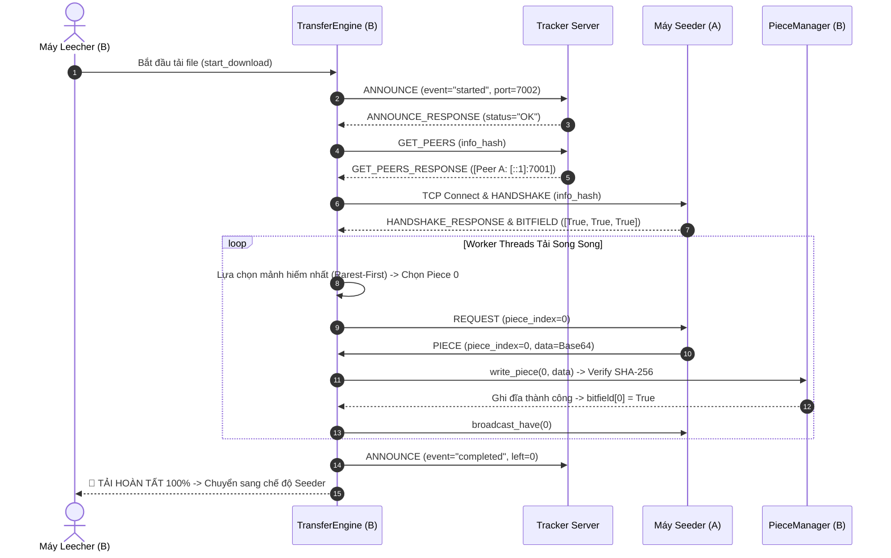

# TÀI LIỆU HƯỚNG DẪN CHI TIẾT & GIẢI THÍCH MÃ NGUỒN DỰ ÁN P2P FILE SHARING

Tài liệu này giải thích chi tiết kiến trúc hệ thống, danh sách tất cả các hàm đã code, tham số đầu vào, kết quả đầu ra, luồng chạy thực tế và logic chi tiết từng dòng code của dự án chia sẻ file ngang hàng (P2P File Sharing).

> Nhánh `feature/direct-ipv6` chỉ dùng TCP IPv6. Tracker và `PeerNode` lắng nghe trên `::`; client mặc định để tracker lấy IPv6 nguồn từ `ANNOUNCE`. Xem [hướng dẫn thử Internet](KE_HOACH_P2P_INTERNET.md) để chạy trên Fedora và Android. Phần mô tả hàm bên dưới là tổng quan kiến trúc; đối chiếu với source hiện tại khi cần chi tiết triển khai.

---

## TỔNG QUAN KIẾN TRÚC MẠNG P2P

```
 +--------------------------------------------------------------------+
 |                           TRACKER SERVER                           |
 |            (Quản lý danh sách Peer chia sẻ file theo Hash)          |
 +--------------------------------------------------------------------+
                   ^                               ^
      1. Announce  |                               | 1. Announce
      & Get Peers  v                               v & Get Peers
       +-----------------------+              +-----------------------+
       |   PEER A (Seeder)     |<============>|   PEER B (Leecher)    |
       |   (Đã có 100% file)   | 2. Direct P2P|   (Đang tải từng     |
       +-----------------------+    Transfer  |    mảnh Piece)        |
                                              +-----------------------+
```

---

## PHẦN 1: GIAO THỨC MẠNG & FRAMING PROTOCOL (`protocol/messages.py`)

File: [protocol/messages.py](file:///home/taitn/Study/Năm 3/PBL4/p2p-file-sharing/protocol/messages.py)

### 1.1. Các hàm xử lý Socket Framing

- **`recv_exact(sock, num_bytes) -> bytes`**: Đọc đúng và đủ `num_bytes` từ socket TCP để giải quyết triệt để vấn đề xé gói (Fragmentation).
- **`send_msg(sock, payload: dict) -> bool`**: Đóng gói Dictionary JSON với **4-byte length prefix** (Big-Endian) trước khi gửi qua TCP socket.
- **`recv_msg(sock) -> dict`**: Đọc 4 byte tiêu đề $\rightarrow$ giải mã lấy độ dài $L$ $\rightarrow$ đọc tiếp đúng $L$ bytes nội dung $\rightarrow$ `json.loads()`.

Sau khi ghép `main` vào nhánh IPv6, `recv_msg()` trả `dict` khi thành công và **ném exception khi lỗi**, theo cách báo lỗi của `main`: `EOFError` nếu socket đóng giữa header/body; `OSError` hoặc `socket.timeout` nếu lỗi mạng; `ProtocolError` (kế thừa `ValueError`) nếu độ dài frame, UTF-8, JSON hoặc kiểu thông điệp không hợp lệ. `send_msg()` trả `True` khi thành công và để lỗi truyền ra bên gọi. Frame được giới hạn 64 MiB trước khi đọc body; giao thức length-prefix và dữ liệu Base64 giữ nguyên.

Engine bắt các lỗi này tại bước tracker, handshake và tải mảnh. Mất kết nối loại peer hiện tại khỏi danh sách đang tải, đóng các socket thuộc peer đó và tạm tránh trong 120 giây. Dữ liệu sai được đếm chung giữa các worker; sau 4 lần lỗi, peer cũng bị tạm loại. Báo cáo `bad_peers` chỉ được gỡ khỏi hàng chờ sau khi tracker xác nhận ANNOUNCE; tracker cần báo cáo từ 2 peer khác nhau để xóa peer bị báo cáo khỏi swarm. Lỗi ghi dữ liệu hợp lệ trên máy nhận không được tính thành lỗi của seeder.

### 1.2. Danh sách Message Builders

- `create_announce_msg()`, `create_get_peers_msg()`, `create_handshake_msg()`, `create_bitfield_msg()`, `create_have_msg()`, `create_request_msg()`, `create_piece_msg()`, `create_keepalive_msg()`.

---

## PHẦN 2: QUẢN LÝ STORAGE & PIECE MANAGER (`storage/`)

### 2.1. Module Metainfo File (`storage/metainfo.py`)

- **`create_metainfo(file_path, piece_length=512KB, tracker_url) -> dict`**: Đọc file gốc, chia thành các chunk 512KB, tính mã băm SHA-256 từng mảnh và mã băm định danh duy nhất `info_hash` cho file.
- **`save_metainfo()`** & **`load_metainfo()`**: Đọc/ghi file `.meta.json`.

### 2.2. Module PieceManager (`storage/piece_manager.py`)

- **`PieceManager.__init__()`**: Khởi tạo mảng `bitfield = [False] * num_pieces` và đối tượng khóa đa luồng `self.file_lock = threading.Lock()`.
- **`_initialize_storage()`**: Tạo file trống và tiền phân bổ dung lượng (`truncate`); việc quét và xác minh mảnh đã có do `verify_all_pieces()` thực hiện khi được gọi.
- **`_get_piece_bounds(piece_index)`**: Tính vị trí byte `offset = piece_index * piece_length` trên đĩa.
- **`read_piece(piece_index)`**: Kiểm tra mảnh đã có chưa, sau đó đọc dữ liệu từ đĩa bọc trong `with self.file_lock:`.
- **`write_piece(piece_index, data)`**: Kiểm tra độ dài và checksum SHA-256 trước. Nếu hợp lệ, ghi xuống đĩa bằng `seek(offset)` và `flush()`, cập nhật `bitfield[piece_index] = True`.

---

## PHẦN 3: MÁY CHỦ TRACKER SERVER (`tracker/`)

### 3.1. Class `TrackerState` (`tracker/state.py`)

- **`register_peer(...)`**: Đăng ký hoặc cập nhật thời gian `last_seen` của Peer trong cấu trúc Swarm `swarms[info_hash]`. Nếu `event == "stopped"`, xóa Peer ra khỏi Swarm.
- **`get_peers(...)`**: Trả về danh sách địa chỉ IPv6 và cổng của các Peer đang chia sẻ file, tự động loại trừ chính nút gửi yêu cầu (`exclude_peer_id`).
- **`cleanup_stale_peers()`**: Quét dọn các Peer "chết" quá thời hạn timeout (60 giây).

### 3.2. Class `TrackerServer` (`tracker/tracker_server.py`)

- **`start()`**: Bind socket `(host, port)`, lắng nghe TCP và khởi chạy luồng ngầm `_accept_loop` và `_periodic_cleanup`.
- **`_handle_client(conn, addr)`**: Tiếp nhận thông điệp JSON từ Peer, phân loại `ANNOUNCE` hoặc `GET_PEERS` và trả về kết quả qua socket.

---

## PHẦN 4: PEER CLIENT & TRANSFER ENGINE (`peer/`)

Đây là bộ não trung tâm điều khiển việc kết nối P2P trực tiếp giữa các nút Peer với nhau và tải dữ liệu song song.

---

### 4.1. Thuật toán chọn mảnh Rarest-First (`peer/selection.py`)

File: [peer/selection.py](file:///home/taitn/Study/Năm 3/PBL4/p2p-file-sharing/peer/selection.py)

#### 🔹 `choose_next_piece(missing_pieces: List[int], peer_bitfields: Dict[str, List[bool]], strategy: str = "rarest_first") -> Optional[int]`
- **Mục đích**: Quyết định mảnh (`piece_index`) nào nên được tải tiếp theo từ danh sách các mảnh còn thiếu `missing_pieces`.
- **Tham số**:
  - `missing_pieces`: Danh sách các chỉ số piece mà local peer chưa có (VD: `[0, 2, 4]`).
  - `peer_bitfields`: Dictionary `{ peer_id: bitfield_list }` của tất cả các Peer đang kết nối với mình.
  - `strategy`: Chuỗi chiến lược (`"rarest_first"` hoặc `"random"`).
- **Trả về**: `int` (Chỉ số mảnh nên tải tiếp), hoặc `None` nếu không có mảnh nào khả dụng.
- **Logic hoạt động**:
  1. Đếm số lượng Peer sở hữu mảnh `i` trong `missing_pieces`.
  2. Tìm tần suất sở hữu nhỏ nhất `min_freq` ($> 0$).
  3. Lọc ra danh sách các mảnh có độ hiếm cao nhất trong mạng P2P.
  4. Trả về mảnh hiếm nhất để luồng worker ưu tiên tải trước.

---

### 4.2. Class `PeerNode` (`peer/peer_node.py`)

File: [peer/peer_node.py](file:///home/taitn/Study/Năm 3/PBL4/p2p-file-sharing/peer/peer_node.py)

Nút Peer đóng vai trò làm Server lắng nghe để phục vụ cho các Peer khác kết nối tới xin mảnh file (Seeding).

#### 🔹 `__init__(peer_id, host, port, piece_manager)`
- Khởi tạo các thuộc tính: `peer_id`, `host`, `port`, `piece_manager`, `info_hash`, và dictionary `active_sockets` lưu danh sách các kết nối P2P đang mở.

#### 🔹 `start_listening()`
- Bật TCP Socket lắng nghe kết nối tại cổng `port` (`bind` + `listen(64)`).
- Khởi chạy luồng chạy ngầm Daemon Thread `_accept_loop()`.

#### 🔹 `_accept_loop()`
- Vòng lặp `accept()` liên tục. Khi có kết nối P2P đến từ Peer khác, tạo 1 luồng worker `_handle_peer_connection(conn, addr)`.

#### 🔹 `_handle_peer_connection(conn, addr)`
- **Logic xử lý**:
  1. Đợi nhận thông điệp `HANDSHAKE` từ đối phương. Kiểm tra `info_hash` trong tin nhắn có đúng với file mình đang mở không.
  2. Phản hồi `HANDSHAKE_RESPONSE` và gửi ngay tin nhắn `BITFIELD` (báo mảng mảnh mình đang sở hữu).
  3. Vào vòng lặp nhận tin nhắn từ đối phương:
     - Nếu nhận `REQUEST(piece_index)`: Đọc dữ liệu mảnh từ đĩa qua `piece_manager.read_piece(piece_index)`, mã hóa Base64 và phản hồi tin nhắn `PIECE(piece_index, data)`.
     - Nếu nhận `KEEP_ALIVE`: Bỏ qua duy trì kết nối.

#### 🔹 `broadcast_have(piece_index: int)`
- **Mục đích**: Phát tin nhắn `HAVE(piece_index)` cho tất cả các Peer đang kết nối mở socket với mình ngay sau khi vừa tải xong 1 mảnh mới.

#### 🔹 `stop()`
- Đặt `is_running = False`, đóng toàn bộ các kết nối socket trong `active_sockets` và đóng `server_socket`.

---

### 4.3. Class `TransferEngine` (`peer/transfer_engine.py`)

File: [peer/transfer_engine.py](file:///home/taitn/Study/Năm 3/PBL4/p2p-file-sharing/peer/transfer_engine.py)

Động cơ đa luồng chịu trách nhiệm hỏi Tracker, mở kết nối P2P tới các máy khác và tải song song các mảnh file.

#### 🔹 `__init__(peer_id, tracker_host, tracker_port, listen_port, piece_manager, max_workers=4)`
- Cấu hình địa chỉ Tracker, nút Peer Listener, và khởi tạo tập hợp `in_flight_pieces` (các mảnh đang được luồng worker tải) cùng đường dẫn file vết tiến độ `.progress.json`.

#### 🔹 `start_download(peer_node=None) -> bool`
- **Logic điều khiển**:
  1. Gửi `ANNOUNCE(event="started")` lên Tracker.
  2. Bắt đầu luồng gửi heartbeat định kỳ `_periodic_announce()`.
  3. Tạo nhóm **Worker Pool** gồm `max_workers` (4 luồng) chạy song song `_worker_loop()`.
  4. Vòng lặp chính ngủ `0.5s` và gọi `_save_progress()`.
  5. Khi `piece_manager.is_complete() == True`: Gửi `ANNOUNCE(event="completed")` báo Tracker đã thành Seeder, xóa file tiến độ và trả về `True`.

#### 🔹 `_announce_to_tracker(event="started") -> List[dict]`
- Mở kết nối TCP ngắn hạn tới Tracker Server, gửi tin nhắn `ANNOUNCE` chứa `downloaded` và `left`.
- Mở tiếp kết nối gửi `GET_PEERS` để lấy về danh sách các máy `[{"peer_id": ..., "ip": ..., "port": ...}]`.

#### 🔹 `_periodic_announce()`
- Một thread điều phối hỏi `GET_PEERS` khoảng 2 giây/lần khi đang tải và gửi heartbeat `ANNOUNCE` khoảng 20 giây/lần; seeder đã hoàn tất tiếp tục heartbeat để không hết hạn trên tracker.

#### 🔹 `_update_peer_connections(peers_list)`
- Duyệt qua danh sách máy nhận từ Tracker. Mở kết nối socket TCP tới các máy mới chưa có trong `connected_peers`, gửi `HANDSHAKE` và nhận tin nhắn `BITFIELD` để cập nhật vào `connected_peers[p_id]`.

#### 🔹 `_worker_loop(worker_id: int)`
- **Vòng lặp của từng luồng Worker**:
  1. Lấy danh sách các mảnh còn thiếu `missing` (loại bỏ các mảnh đang được luồng khác tải trong `in_flight_pieces`).
  2. Gọi `choose_next_piece()` theo thuật toán **Rarest-First** để chọn chỉ số mảnh `target_piece` tốt nhất.
  3. Thêm `target_piece` vào `in_flight_pieces` để các luồng khác không tải trùng.
  4. Gọi `_download_piece_from_peer(...)` qua socket riêng của worker để xin dữ liệu mảnh.
  5. Xóa `target_piece` khỏi `in_flight_pieces`.

#### 🔹 `_download_piece_from_peer(piece_index, peer_id, ip, port, worker_id) -> bool`
- Dùng peer đã được chọn khi giữ chỗ mảnh dưới lock.
- Gửi tin nhắn `REQUEST(piece_index)` qua TCP socket tới máy đó.
- Nhận thông điệp `PIECE`, giải mã Base64 dữ liệu.
- Gọi `piece_manager.write_piece(piece_index, data)` để ghi đĩa và kiểm tra checksum SHA-256.
- Nếu thành công, gọi `peer_node.broadcast_have(piece_index)` để phát tin tức cho toàn mạng P2P.

#### 🔹 `_save_progress()` & `_remove_progress_file()`
- Ghi đĩa file `.progress.json` chứa `info_hash` và mảng `bitfield` phục vụ việc Resume download khi tạm ngắt chương trình.

#### 🔹 `stop()`
- Dừng `is_running = False` và đóng toàn bộ các kết nối socket trong `connected_peers`.

---

## 🔄 LUỒNG CHẠY TỔNG THỂ KHI 1 PEER TẢI FILE (EXECUTION FLOW)


