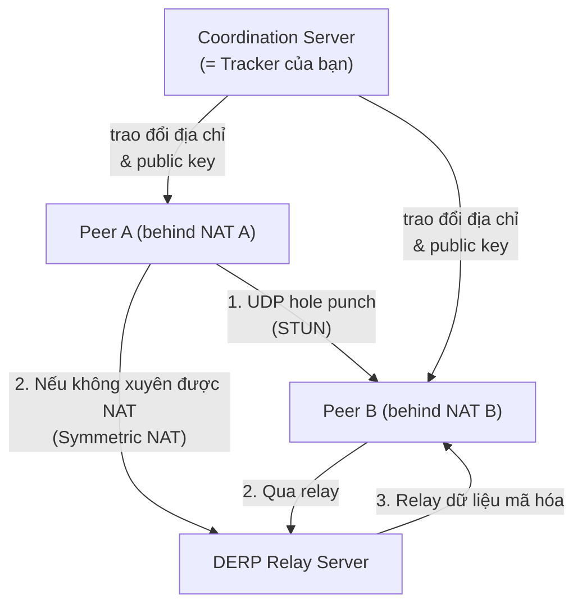
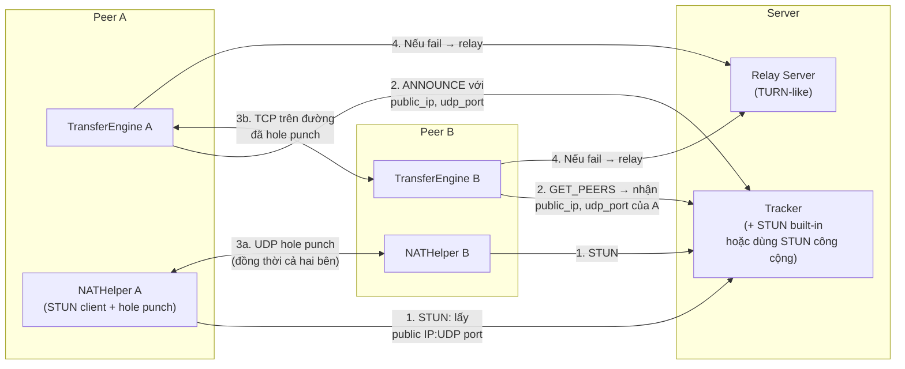
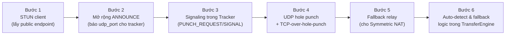

# Kế hoạch NAT Traversal cho P2P File Sharing

> [!NOTE]
> Dự án đã truyền file thành công qua Tailscale (VPN overlay). Bước tiếp theo là **xây dựng NAT traversal độc lập** — không cần Tailscale — bằng cách học theo kiến trúc mà Tailscale dùng bên dưới.

---

## 1. Tailscale làm NAT traversal thế nào?

Tailscale dùng **ba tầng kết nối**, thử theo thứ tự ưu tiên:



| Kỹ thuật | Mô tả | Khi nào dùng |
|---|---|---|
| **Direct connection** | 2 peer cùng LAN hoặc đã có public IP | Luôn thử trước |
| **UDP hole punching** (STUN) | Peer hỏi STUN server lấy public IP:port, trao đổi qua Tracker, đồng thời gõ "lỗ" qua NAT | Peer sau NAT Cone (Full-Cone, Restricted-Cone, Port-Restricted) |
| **DERP relay** (Tailscale) / **TURN** (WebRTC) | Relay server trung gian, gói dữ liệu đi vòng qua server | Symmetric NAT – không hole punch được |

> [!IMPORTANT]
> **Điểm quan trọng nhất của Tailscale**: Họ dùng **UDP** (qua WireGuard) để hole punch, không phải TCP. TCP hole punching khó hơn nhiều và không phổ biến. Tailscale bọc toàn bộ lưu lượng vào **WireGuard tunnel UDP**, sau đó dùng STUN/ICE để tìm đường kết nối.

---

## 2. Hiện trạng code của bạn

| Thành phần | Hiện tại | Cần thêm |
|---|---|---|
| **Transport** | TCP thuần | Giữ TCP cho data; thêm UDP cho hole punch |
| **Tracker** | Lưu IP:Port peer báo cáo | Thêm: lưu **public IP:Port** thực (từ TCP socket) + endpoint UDP |
| **`_connect_and_handshake()`** | Kết nối thẳng IP:Port | Thêm: thử hole punch UDP trước |
| **`create_announce_msg()`** | Báo `ip` (LAN) | Thêm: báo `nat_type` + UDP `mapped_port` |
| **Fallback** | Không có | Thêm: TURN/relay server |

---

## 3. Kiến trúc đề xuất — 3 tầng kết nối



---

## 4. Các module cần xây dựng

### Module 1: `nat/stun_client.py` — Lấy public endpoint

Giao thức **STUN RFC 5389** — dùng server công cộng như `stun.l.google.com:19302`.

```
Client → STUN server (UDP):  Binding Request
STUN server → Client (UDP):  Binding Response { XOR-MAPPED-ADDRESS: <public_ip>:<public_port> }
```

**Việc cần làm:**
- Bind UDP socket cố định (lưu lại port này).
- Gửi STUN Binding Request, parse response lấy `(public_ip, public_port)`.
- Xác định loại NAT: Full-Cone, Restricted, Port-Restricted, Symmetric.

### Module 2: `nat/hole_punch.py` — UDP hole punching

**Quy trình hole punch qua Tracker (signaling):**

```
Peer A                    Tracker                    Peer B
  |                          |                          |
  |-- ANNOUNCE (public_udp_endpoint) -->               |
  |                          |<-- GET_PEERS response ---|
  |<-- Tracker báo endpoint của B via response --------|
  |                          |                          |
  |=== đồng thời (race) ========================|
  |-- UDP packet --> [NAT A mở lỗ]   [NAT B mở lỗ] <-- UDP packet --|
  |<================ UDP kết nối 2 chiều ================|
  |                                                      |
  |---- TCP connect() trên UDP socket đã hole punch ----->|
```

> [!WARNING]
> **Hole punch yêu cầu cả hai bên gửi đồng thời**. Cần Tracker làm "signaling server" để điều phối timing — thêm message mới `PUNCH_REQUEST` / `PUNCH_READY`.

### Module 3: Mở rộng Tracker làm Signaling Server

Thêm message types mới vào `protocol/messages.py`:

```python
PUNCH_REQUEST   = "PUNCH_REQUEST"   # Peer xin lỗ thủng để kết nối peer khác
PUNCH_SIGNAL    = "PUNCH_SIGNAL"    # Tracker relay thông tin cho cả 2 peer
PUNCH_READY     = "PUNCH_READY"     # Peer báo sẵn sàng punch
```

Tracker cần giữ **persistent connection** với peer (thay vì close-after-response như hiện tại) để push `PUNCH_SIGNAL` bất đồng bộ.

### Module 4: `nat/relay.py` — Fallback relay (TURN-like)

Khi Symmetric NAT chặn hole punch, dữ liệu đi qua relay server:

```
Peer A --> [mã hóa] --> Relay --> [chuyển tiếp] --> Peer B
```

**Giản lược nhất**: Relay mở 2 TCP socket (1 với A, 1 với B), pipe dữ liệu giữa 2 socket.

---

## 5. Thứ tự triển khai (ưu tiên)



### Bước 1: STUN client (1–2 ngày)
- File mới: `nat/stun_client.py`
- Dùng server công cộng (`stun.l.google.com:19302`)
- Trả về `(public_ip, public_udp_port, nat_type)`
- Không phụ thuộc thêm thư viện (implement STUN Binding Request thủ công ~30 dòng)

### Bước 2: Mở rộng ANNOUNCE (nhanh, ~1 ngày)
- Sửa `create_announce_msg()` → thêm `udp_port`, `public_ip`
- Sửa `TrackerState.register_peer()` → lưu `udp_port`, `public_ip`
- Sửa `TrackerState.get_peers()` → trả về `public_ip`, `udp_port`

### Bước 3: Signaling trong Tracker (~2 ngày)
- Tracker giữ TCP connection lâu dài với peer (dùng persistent socket + queue)
- Thêm `_handle_punch_request()` trong `tracker_server.py`
- Relay `PUNCH_SIGNAL` đến cả 2 peer khi cả 2 sẵn sàng

### Bước 4: Hole punch logic (~2–3 ngày)
- File mới: `nat/hole_punch.py`
- Bind UDP socket → lấy public endpoint → gửi PUNCH_REQUEST lên Tracker
- Nhận PUNCH_SIGNAL từ Tracker → bắt đầu gửi UDP packet "lỗ thủng"
- Sau khi punch thành công: `sock.connect()` TCP trên cùng IP:port đó

### Bước 5: Relay fallback (~1–2 ngày)
- File mới: `nat/relay_server.py` (deploy trên VPS)
- `nat/relay_client.py` — fallback khi punch fail

### Bước 6: Tích hợp vào TransferEngine (~1 ngày)
- Sửa `_connect_and_handshake()`: thử Direct → Hole punch → Relay

---

## 6. Thách thức & giới hạn thực tế

| Thách thức | Giải pháp |
|---|---|
| **Symmetric NAT** (phổ biến ở mobile 4G/5G) | Bắt buộc relay server; không hole punch được |
| **Timing đồng bộ** hole punch | Tracker signaling phải push đến cả 2 peer trong <1 giây |
| **TCP hole punch khó hơn UDP** | Dùng UDP socket để punch lỗ, sau đó kết nối TCP qua đó (hoặc chuyển data qua UDP) |
| **Port mapping thay đổi** (Symmetric NAT) | Predict port (heuristic) hoặc thẳng relay |
| **Firewall chặn UDP** | Fallback TCP relay |

> [!TIP]
> Nếu muốn giống Tailscale hơn, hãy xem xét dùng **QUIC** (UDP-based) thay cho TCP cho data transfer — vừa dễ hole punch hơn, vừa có flow control tốt hơn UDP thuần.

---

## 7. Bắt đầu từ đâu?

**Bước 1 ngay bây giờ**: Viết `nat/stun_client.py` để kiểm tra:
1. STUN trả về public IP gì?
2. NAT type là gì (Cone hay Symmetric)?

Sau khi biết NAT type, mới biết hole punch có khả thi không và cần relay mức nào.

```bash
# Kiểm tra nhanh NAT type bằng stunclient (nếu có)
python3 -c "
import socket, struct
# Gửi STUN Binding Request thủ công tới stun.l.google.com:19302
s = socket.socket(socket.AF_INET, socket.SOCK_DGRAM)
s.settimeout(3)
req = struct.pack('>HHI12s', 0x0001, 0, 0x2112A442, b'\\x00'*12)
s.sendto(req, ('stun.l.google.com', 19302))
data, _ = s.recvfrom(1024)
print('Public IP response len:', len(data))
s.close()
"
```
